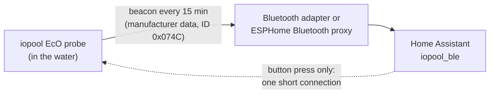

# iopool EcO — Bluetooth for Home Assistant

Home Assistant integration that reads an **iopool EcO** pool and spa water probe locally over
Bluetooth LE — pH, ORP and temperature from the probe's own broadcasts, with no iopool
cloud, gateway, account or subscription, and it works through ESPHome Bluetooth proxies.

## What it does

- **Reads the probe passively.** The EcO broadcasts each measurement in a Bluetooth
  advertisement. The integration decodes it; it never connects to take a reading, so it
  uses no connection slot and works through any Bluetooth proxy that can hear the probe.
- **Lets you calibrate the probe yourself.** The probe sends raw values; iopool's
  conversion to real units lives in their cloud. Here you enter reference readings (a pH
  buffer, an ORP solution, a thermometer) and the integration fits the conversion. Until a
  quantity is calibrated, its calibrated sensor is **unavailable** — it never shows a guess.
- **Says when the probe has stopped measuring.** Readings go unavailable when no **new**
  measurement has arrived within a set time (60 minutes by default). A probe that keeps
  repeating one old beacon counts as stale, however recently it was heard.
- **Three buttons that connect briefly** — *Read firmware version*, *Identify (beep)* and
  *Measure now*. Each press makes one short connection and drops it.

## Supported device

The **iopool EcO** probe (Bluetooth manufacturer ID `0x074C`, beacon layout 1). Firmware
`v0.4.2` has been read from a working probe. The iopool gateway is not needed and not used.

## Install

### HACS (custom repository)

Until the integration is in the HACS default list:

1. HACS → three-dot menu → **Custom repositories**
2. Add `https://github.com/pete-jorgensen/iopool-ble`, category **Integration**
3. Install **iopool EcO (Bluetooth)**, then restart Home Assistant

### Manual

Copy `custom_components/iopool_ble` into your `config/custom_components/` directory and
restart Home Assistant.

Needs Home Assistant 2024.11 or later, with Bluetooth set up (a local adapter or an ESPHome
Bluetooth proxy within range of the probe).

## Setup

The probe is **discovered automatically** once an adapter or proxy hears it — accept the
notification. To add it by hand: **Settings → Devices & services → Add integration →
iopool EcO**. Only probes heard recently are listed, and the probe broadcasts rarely, so
the list may be empty for a few minutes after a restart.

## Entities

**Calibrated** (unavailable until calibrated)

| Entity | Unit |
| --- | --- |
| pH | pH |
| ORP | mV |
| Temperature | °C |

**Raw and diagnostic**

| Entity | What it is |
| --- | --- |
| pH raw, ORP raw | the probe's raw values, signed |
| Thermistor resistance | the temperature sensor, in Ω |
| Conductivity raw | raw; not calibrated by this integration |
| Battery | % |
| Beacon sequence | counts up with each new measurement |
| Last new reading | when the latest *new* measurement arrived; stays available so staleness is visible |
| Last beacon type | measurement, start-up test pattern, or blank |
| Firmware version | filled by the *Read firmware version* button |
| Signal strength, Mode, Activity, Minute counter | disabled by default |

**Buttons**

| Button | Effect |
| --- | --- |
| Read firmware version | reads the version; changes nothing on the probe |
| Identify (beep) | the probe beeps |
| Measure now | asks the probe for five live measurements |

The buttons need an adapter or proxy that can **connect** (an ESPHome proxy with active
connections enabled), and the probe accepts one connection at a time — a press fails while
the iopool phone app is connected to it. A failed press raises an error that says why.
Reset and the mode-change commands are deliberately not implemented.

## Calibration

Open the probe's entry → **Configure** → **Add a calibration point**. The form shows the
live raw values. Put the probe in a reference, wait for the raw value to settle (the probe
measures every 15 minutes, so the value must come from a beacon sent after it settled),
then enter the trusted value. Leave the raw box blank to use the live value, or type a raw
value you noted earlier.

| Quantity | Reference | Points |
| --- | --- | --- |
| pH | buffer solutions, e.g. pH 7 and pH 4 | 2, ideally 3 |
| ORP | ORP reference solutions, e.g. 225 mV and 470 mV | 2 |
| Temperature | a thermometer in the same water, at two well-separated temperatures | 2, ideally 3 |

Two points at different raw values fix a quantity; more points are combined by least
squares. pH and ORP are a straight line. Temperature uses the thermistor beta model
(`1/T = a + b·ln R`). The fit is stored in the entry's options, per probe, so a
replacement probe starts uncalibrated. **Clear calibration points** starts a quantity again.
pH is not temperature-compensated.

What one probe showed, as a starting point and not a substitute for references: raw ORP
tracked the iopool app's ORP in millivolts almost exactly; raw pH behaved like the
electrode's millivolts about pH 7 (negative above pH 7); and the thermistor matched a
10 kΩ, beta 3950 part. The iopool app's own readings, taken alongside a beacon, are usable
reference points while you still have the app.

**Settings** (same menu) sets how many minutes without a new beacon before readings go
unavailable.

## Layout

| Path | What |
| --- | --- |
| `custom_components/iopool_ble/parser.py` | the beacon decode, with the byte layout; no Home Assistant imports |
| `custom_components/iopool_ble/calibration.py` | the calibration maths; no Home Assistant imports |
| `custom_components/iopool_ble/coordinator.py` | the passive Bluetooth coordinator and the staleness rule |
| `custom_components/iopool_ble/active.py` | the connected side behind the buttons |
| `tests/` | parser tests over real beacon payloads, and calibration tests |

Run the tests with `python -m pytest tests -q` (needs only `pytest`).

## Status

Early. The readings and calibration run in a live Home Assistant instance, and *Read
firmware version* and *Identify* have worked against a real probe; whether *Measure now*
makes the probe measure at once is not yet confirmed. Tested against one
probe; reports from other probes and firmware versions are welcome.

Not affiliated with iopool.

## Licence

MIT.
